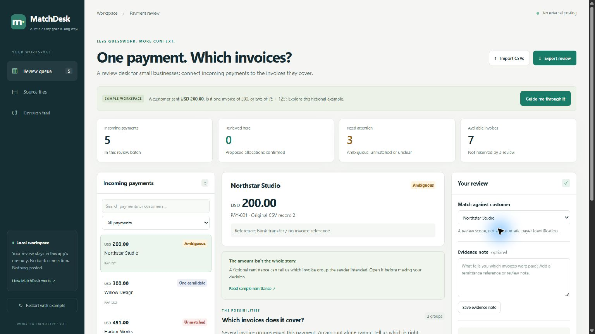
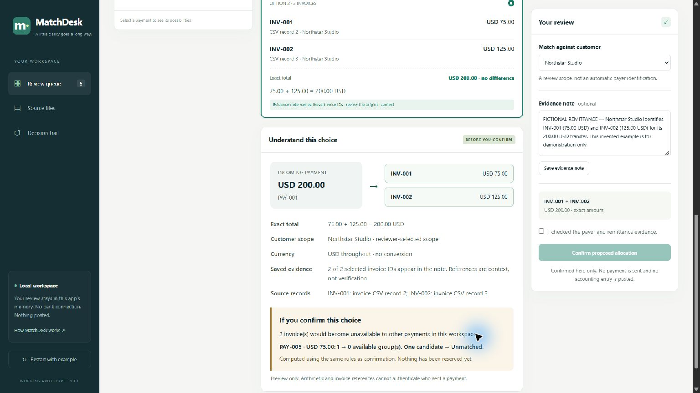
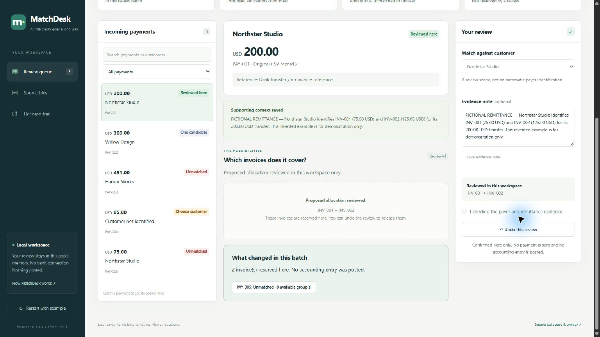

# MatchDesk

A local payment-review workspace for freelancers, bookkeepers and small businesses working from invoice and payment CSV exports. MatchDesk shows which invoice groups fit a payment, lets a person inspect the evidence and consequences, and records their proposed allocation.

**Project owner and contributor:** [Ziyad Azzaz (@ZiyadAzzaz)](https://github.com/ZiyadAzzaz). Built with AI coding assistance; see [contributors and attribution](AUTHORS.md).

Public source: [ZiyadAzzaz/matchdesk-build-with-ai-2026](https://github.com/ZiyadAzzaz/matchdesk-build-with-ai-2026). See [release handoff](devpost/final-handoff.md) for completed checks and remaining demo/submission work.

**[Watch the 1:52 working demo on YouTube](https://youtu.be/xOIa8LFVFh0)** — narrated by Ziyad Azzaz, with English captions and fictional sample data.

## What problem does it solve?

An invoice is a request for payment. Receiving money does not always tell a business which invoices the customer intended to pay. A missing reference or several matching amounts can leave a reviewer comparing spreadsheet rows and checking the customer's payment note, also called a remittance.

For example, a customer has three outstanding invoices:

| Invoice | Amount |
|---|---:|
| INV-001 | USD 75.00 |
| INV-002 | USD 125.00 |
| INV-003 | USD 200.00 |

A **USD 200.00 payment** fits INV-003 **or** INV-001 + INV-002. Both sums are correct. The customer's note supplies the context needed to decide. MatchDesk keeps those alternatives visible, connects the choice to source records and evidence, and shows what would happen to the other payments in the batch before confirmation.

## Why this project?

This prototype focuses on one complete review task: import files → compare alternatives → inspect evidence and consequences → confirm → export or undo. Its purpose is to make the reasoning inspectable and prevent the same invoice being reused across locally reviewed allocations. The guided fictional example makes the task approachable without connecting a bank or entering real customer data.

We chose this project after reviewing public discussions where people described the difficulty of connecting incoming payments to the right invoices. Missing references, inconsistent payer names and identical amounts can force people to compare records manually. MatchDesk focuses on the ambiguous-choice part of that workflow: make the alternatives and consequences visible, then let a person decide with evidence.

Examples that informed the problem choice:

- A [small-business Reddit discussion](https://www.reddit.com/r/smallbusiness/comments/1sergd6/dealing_with_messy_payment_reconciliation_how_do/) describes missing invoice references, mismatched payer names and manual cross-checking between records.
- A [QuickBooks Reddit question](https://www.reddit.com/r/QuickBooks/comments/1ksckhr/) asks how to identify the right customer when several invoices have the same amount.

These discussions illustrate a **recurring reported workflow problem**. They are qualitative motivation, not a representative survey or a trial of MatchDesk. Some issues mentioned in those threads, such as partial payments, remain outside this prototype. See the [evidence and existing-solutions review](docs/problem-evidence.md) for sources, limits and competing tools.

## What you can do

| Action | What the app actually does |
|---|---|
| Import two CSV files | Preview columns, map fields and reject invalid imports without replacing the current review |
| Compare possible matches | Compute exact invoice groups within the selected customer and currency |
| Inspect the reasoning | Show amounts, original CSV records and saved invoice references |
| Preview a decision | Apply the actual allocation rules to a copy and show affected payments without reserving anything |
| Confirm or undo | Require a human acknowledgment, reserve invoices locally, and keep a decision trail |
| Export the review | Download proposed allocations as CSV or detailed evidence/history as JSON |

The interface uses HTML/CSS/JavaScript with a small Python API. Matching is deterministic; no API key, account or frontend build step is needed. Confirmations stay in this workspace: no money moves and no accounting ledger is updated. Established accounting and reconciliation tools already cover related tasks; this is a focused prototype whose usability advantage still needs evaluation.

## Screenshots from the working app

Captured from the real local Chrome workspace using fictional sample data. Open an image at full size to inspect the amounts and evidence.

**Review the incoming payment and its context.**



**Check the evidence and the effect before confirming.** The preview shows that allocating INV-001 + INV-002 would leave PAY-005 without an available group.



**Confirm a proposed allocation and see what changed.** The invoices are reserved here; no external accounting entry is posted.



Also see [both matching alternatives](docs/screenshots/02-ambiguous-invoice-choices.jpg), the [decision trail](docs/screenshots/05-decision-trail.jpg), and [media capture notes](docs/demo-media.md).

## Open the app

In this workspace, **double-click `Start-MatchDesk.cmd`**. It discovers a local `.venv`, an active Conda environment or the existing `zero-dev` environment, verifies the required modules and opens **http://127.0.0.1:8503**. Keep the console window open while using it. `Start-MatchDesk.ps1 -Check` verifies the interpreter without starting a browser or server. Override selection with `MATCHDESK_PYTHON` if necessary.

Fresh setup, Python 3.11:

```powershell
git clone https://github.com/ZiyadAzzaz/matchdesk-build-with-ai-2026.git
cd matchdesk-build-with-ai-2026
python -m venv .venv
.\.venv\Scripts\python.exe -m pip install -r requirements-lock.txt
.\.venv\Scripts\python.exe -m matchdesk --open-browser
```

Linux/macOS use `.venv/bin/python`. Existing workspace alternative:

```powershell
conda activate zero-dev
cd "path\to\matchdesk-build-with-ai-2026"
python -m matchdesk
```

Open http://127.0.0.1:8503. If that port is occupied: `python -m matchdesk --port 8504`. All servers bind to loopback. Optional Conda recipe: `conda env create -f environment.yml`, then `conda activate matchdesk`. Creating this second Conda environment is not required and was not independently tested.

## The example, end to end

All sample companies, invoices, payments and remittance notes are fictional.

New here? Click **Guide me through it**. The five-step guide explains the problem and takes you through the real controls. It never selects or confirms an allocation for you. You can exit without losing your decisions.

1. Select **PAY-001 · USD 200.00**. The server computes two valid arithmetic groups: **INV-003 (200)** or **INV-001 + INV-002 (75 + 125)**. Neither is chosen automatically.
2. Click **Read sample remittance**. The fictional note identifies INV-001 and INV-002. Click **Use this evidence note**.
3. Click the matching two-invoice card. Check **I checked the payer and remittance evidence**, then **Confirm proposed allocation**.
4. The payment becomes **Reviewed here**. The two invoices are reserved locally. PAY-005 (75.00) now has no available exact allocation; the same invoice cannot be used twice.
5. Open **Decision trail**, inspect original **Source files**, and **Export review** as CSV or JSON. **Undo this review** releases the invoices and records that action.
6. PAY-002 illustrates one arithmetic candidate, PAY-003 no exact match, and PAY-004 an unidentified customer. Select its matching customer explicitly; amount alone never identifies a payer.

"Reviewed here" means a person confirmed a proposed allocation in this session. It does not prove the payer's identity, authenticate remittance, mark a real invoice paid or post an accounting entry. Exact arithmetic is not transaction identity.

Before confirming, **Understand this choice** connects the payment to selected invoices, shows the equation and original CSV records, and distinguishes saved references from identity verification. Its **If you confirm this choice** preview uses the real allocation rules on a separate copy: choosing 75 + 125 leaves PAY-005 without an available exact group; choosing 200 does not. Try both cards. Previewing never reserves invoices, writes a decision or changes history. After a real confirmation, the result links to payments whose status or candidate count actually changed.

## Your own CSV exports

Click **Import CSVs** and choose two UTF-8, comma-separated files (BOM accepted). Template downloads are available there. Preview both, choose each column mapping, acknowledge replacing the current workspace and import. A failed import leaves existing decisions unchanged; no rows are silently skipped. Changing a file invalidates its old preview. Selecting files does not itself import or replace data.

| File | Required mapped columns | Optional columns |
|---|---|---|
| Outstanding invoices | ID, customer, currency, amount | — |
| Incoming payments | ID, currency, amount | Customer, reference |

IDs are strings, so leading zeros survive. Each file must have unique IDs. Amounts must be positive plain decimal strings with no thousands separators, exponent or more than two fractional digits. Required fields cannot have surrounding whitespace. Supported currencies: USD, EUR, GBP, EGP, CAD, AUD; they are never converted or added across currencies.

Limits: 256 KB/file; 30 columns; 200 invoice records; 60 payment records; 2,000 characters/field; 16 available invoices per selected customer/currency for exhaustive matching. Up to 30 candidate groups are displayed, with the full count retained. Over-limit searches require review rather than claiming uniqueness. CSV record numbers include the header and are not physical line numbers when fields contain quoted newlines. Remaining import details and source hashes are in JSON exports.

## Data handling and boundaries

The browser sends CSV text to the server running the app. In local use that is this computer. Records, notes, proposals and their trail live in process memory, scoped to a browser cookie; they are not written to an application database or sent to an external AI/bank service. Session data expires after 90 minutes without API activity and is lost on restart or replacement. It is not secure memory erasure. Downloads intentionally persist and include supplied customer/financial text; inspect them before sharing.

The local API checks mutations against the current revision, revalidates allocations server-side, blocks double use and rejects stale/expired sessions. This is not a public multi-user financial service. No accounting advice, refunds, fee inference, partial allocations, credit notes, FX, fuzzy payer guesses or automatic external writes. CSV exports neutralize formula-like text prefixes; JSON preserves exact supplied strings and structured provenance. CSV consumers may still automatically reinterpret identifiers—use the JSON report when exact string preservation matters.

## Reproduce the checks

Python:

```powershell
python -m pip install -r requirements-dev.txt
python -m pytest -q
python -m ruff check .
```

Frontend interaction tests require Node.js 22+ **for development only**:

```powershell
npm ci
$env:MATCHDESK_TEST_PYTHON = (Get-Command python).Source
npm test
```

Activate the intended Python environment first. The frontend tests launch their own isolated local Python process and supply real CSVs through DOM controls to the real API. They cover evidence, selection, acknowledgments, approvals, reservation, undo, import mappings, invalidated previews, unknown customers, draft-note preservation, HTML-safe rendering and CSS parsing. They do **not** paint the page, inspect responsive layout or drive the OS file chooser. Python tests cover exact money, search completeness, validation, imports, reservations, stale revisions, expired cookies, session isolation and exports. A framework deprecation warning about the `httpx` TestClient backend is recorded rather than hidden.

## Project and competition records

`matchdesk/engine.py` parses and matches; `review.py` owns proposed decisions and exports; `server.py` exposes the local API; `static/` contains the complete browser workspace. Planning records and [reference code map](devpost/app-map.html) are in `devpost/`. The [official Skill Pack](https://github.com/challengepost/learn-ai-basics) was installed in this isolated folder; `skills-lock.json` records its source hashes. Personal profile and local skill installations are excluded from releases. Draft planning status distinguishes delegated implementation from unreported personal review.

See [verification](devpost/verification.md), [recording actions](devpost/recording-checklist.md) and [submission readiness](devpost/submission-readiness.md). Existing tools cover related tasks; this prototype explores a focused, inspectable review experience. Customer trials and comparable measurements are needed before claiming a usability advantage or time saved. The source and screenshots are published, and Ziyad has supplied the [uploaded demo link](https://youtu.be/xOIa8LFVFh0). Signed-out playback and the final Devpost entry still need confirmation.
